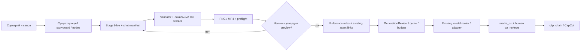

# RFC: локальный Blender previz в существующем GremoVOD

Статус: PROPOSED, 2026-10-24. Это спецификация, не реализованный модуль. Доказательства текущего состояния: [аудит](BLENDER_INTEGRATION_AUDIT_2026-10-24.md). Цель P0 — один визуально принятый локальный шот; цель P1 — один принятый AI-шот. Автоматическая консистентность не доказана.

## Выбор архитектуры

| Вариант | Установки / Windows | Воспроизводимость и UI | Цена и риски | Решение |
|---|---|---|---|---|
| Python API + headless CLI | Portable Blender, Python внутри Blender, имеющийся FFmpeg; внешняя venv только для validator | JSON + pinned script/version/hash, batch без UI; UI полезен для ручной подготовки master | Нет оплаты AI за render; электричество/время/моделирование остаются. Произвольный Python и `.blend` требуют изоляции | **P0/P1** |
| Официальный Blender MCP | Blender 5.1+, add-on, MCP server, совместимый LLM client; установка каждого компонента отдельно | Интерактивная режиссура; журнал чата сам по себе не воспроизводит stage | LLM usage, больше компонентов; возможность исполнения Python, удаления и утечки данных | Не устанавливать в этой задаче |
| Гибрид | CLI как production path, MCP только в отдельной VM без секретов | Интерактивный результат экспортируется в reviewed master + manifests, затем CLI | Дороже сопровождение, но production не зависит от live agent | P2 только при доказанной пользе |

[Официальный Blender MCP](https://www.blender.org/lab/mcp-server/) требует Blender 5.1+ и отдельно установленные компоненты; встроенной LLM в Blender нет. Сайт прямо предупреждает о рисках исполняемого кода. Community Blender MCP — другой продукт: его зависимости и права нельзя выдавать за свойства официального server.

Для Windows разумно начать с **portable LTS** из [официальных releases](https://www.blender.org/releases/), закрепив точную версию и checksum перед установкой. На дату исследования releases перечисляет 5.2 LTS и 4.5 LTS; страницы download/cache расходятся по patch-версии, поэтому конкретный zip здесь не объявляется установленным или проверенным. Для CLI совместимую LTS выбрать по локальному smoke; 4.5 LTS не удовлетворяет требованию официального MCP 5.1+.

[Системные требования](https://www.blender.org/download/requirements/): минимум 4 CPU cores/SSE4.2, 8 GB RAM, 2 GB GPU; рекомендовано 8 cores, 32 GB RAM, 8 GB GPU. Требования графического backend и расширений драйвера проверяются отдельно. Наш i7-6700K/GTX950 2 GB находится у нижней границы; RAM UNKNOWN. Workbench/simple Eevee — кандидаты, CPU Cycles — возможный медленный fallback после smoke, не гарантия работоспособности. Покупку GPU до замера не предлагать.

## Конвейер и границы



Blender — локальный инструмент подготовки ассета, не новый workflow engine. P0 выполняется вручную в изолированном каталоге без серверной интеграции. P1 связывает результаты с production node; P2 может использовать существующий activity job lifecycle и UI. Никаких новых баз, независимого бюджетного сервиса или локального shell в cloud n8n. Master никогда не изменяется при рендере: копия на попытку, проверка хеша до/после.

## Размещение

Предлагаемые пути, **ещё не созданные**:

```text
Git:
  scripts/blender/{validate_manifests.py,render_shot.py,run_preflight.py}
  schemas/blender/previz-v1.schema.json
  skills/gremovod-blender-consistency/SKILL.md
  backend/production_entities.py, production_folders.py  # extensions
Runtime under explicitly selected isolated STUDIO_DATA_DIR:
  productions/<production-id>/nodes/<shot-node-id>/previz/<revision>/
    stage_bible.json
    shot_manifest.16x9.json, shot_manifest.9x16.json
    reference_manifest.json, generation_manifest.json, qc_report.json
    master/<asset-version>.blend
    attempts/<attempt-id>/{scene.blend,frames/,preview.mp4,preflight.json,render.log}
```

Это логическая раскладка под существующими production paths; фактический path resolver и ownership берутся из `production_folders.py`. Нельзя принимать произвольный absolute path из HTTP. Media/`.blend`/проектные manifest с IDs и приватными путями — runtime, не Git; schemas, код, обезличенные fixtures — Git. Импорт через существующий registry требует доработки allowlist и sidecar metadata. Не использовать workspace promotion для этого.

## JSON-контракт v1

Ниже компактная **предлагаемая** JSON Schema Draft 2020-12. Она описывает минимальные records, а не изменения текущих API. Один envelope на документ; ссылки на существующие entity/file IDs. Версия renderer и реальные SHA обязательны перед выполнением. В примерах `0` × 64 — **заглушка**, которую semantic preflight обязан отвергать; примеры не являются разрешением запускать render/генерацию.

```json
{
  "$schema": "https://json-schema.org/draft/2020-12/schema",
  "$id": "urn:gremovod:previz:v1",
  "oneOf": [
    {"$ref": "#/$defs/stage"}, {"$ref": "#/$defs/shot"},
    {"$ref": "#/$defs/references"}, {"$ref": "#/$defs/generation"}, {"$ref": "#/$defs/qc"}
  ],
  "$defs": {
    "hash": {"type": "string", "pattern": "^[a-f0-9]{64}$"},
    "vec3": {"type": "array", "items": {"type": "number"}, "minItems": 3, "maxItems": 3},
    "ids": {"type": "array", "items": {"type": "string", "minLength": 1}, "uniqueItems": true},
    "asset": {
      "type": "object", "additionalProperties": false,
      "required": ["entity_id", "file_id", "version", "sha256"],
      "properties": {"entity_id": {"type": "string"}, "file_id": {"type": "string"}, "version": {"type": "string"}, "sha256": {"$ref": "#/$defs/hash"}}
    },
    "stage": {
      "type": "object", "additionalProperties": false,
      "required": ["kind", "schema_version", "stage_id", "units", "axes", "physical_left", "north", "assets", "landmarks", "invariants"],
      "properties": {
        "kind": {"const": "stage_bible"}, "schema_version": {"const": "1.0"}, "stage_id": {"type": "string"},
        "units": {"const": "m"}, "axes": {"const": "X_forward_Y_left_Z_up"}, "physical_left": {"const": "+Y"},
        "north": {"$ref": "#/$defs/vec3"}, "assets": {"type": "array", "minItems": 1, "items": {"$ref": "#/$defs/asset"}},
        "landmarks": {"type": "object", "additionalProperties": {"$ref": "#/$defs/vec3"}},
        "invariants": {"$ref": "#/$defs/ids"}
      }
    },
    "key": {
      "type": "object", "additionalProperties": false, "required": ["frame", "position_m", "look_at_m"],
      "properties": {"frame": {"type": "integer", "minimum": 0}, "position_m": {"$ref": "#/$defs/vec3"}, "look_at_m": {"$ref": "#/$defs/vec3"}}
    },
    "shot": {
      "type": "object", "additionalProperties": false,
      "required": ["kind", "schema_version", "episode_id", "scene_id", "shot_id", "stage_id", "stage_sha256", "aspect", "fps", "start_frame", "end_frame_exclusive", "camera", "beats", "continuity"],
      "properties": {
        "kind": {"const": "shot_manifest"}, "schema_version": {"const": "1.0"},
        "episode_id": {"type": "string"}, "scene_id": {"type": "string"}, "shot_id": {"type": "string"}, "stage_id": {"type": "string"}, "stage_sha256": {"$ref": "#/$defs/hash"},
        "aspect": {"enum": ["16:9", "9:16"]}, "fps": {"type": "integer", "minimum": 1, "maximum": 60},
        "start_frame": {"type": "integer", "minimum": 0}, "end_frame_exclusive": {"type": "integer", "minimum": 1},
        "camera": {
          "type": "object", "additionalProperties": false, "required": ["lens_mm", "sensor_width_mm", "interpolation", "keys"],
          "properties": {"lens_mm": {"type": "number", "exclusiveMinimum": 0}, "sensor_width_mm": {"type": "number", "exclusiveMinimum": 0}, "interpolation": {"enum": ["linear", "bezier_clamped"]}, "keys": {"type": "array", "minItems": 2, "items": {"$ref": "#/$defs/key"}}}
        },
        "beats": {"type": "array", "items": {"type": "object", "additionalProperties": false, "required": ["frame", "entity_id", "action", "visible_ids"], "properties": {"frame": {"type": "integer"}, "entity_id": {"type": "string"}, "action": {"type": "string"}, "visible_ids": {"$ref": "#/$defs/ids"}}}},
        "continuity": {"type": "object", "additionalProperties": false, "required": ["previous_shot_id", "required_last_visible_ids"], "properties": {"previous_shot_id": {"type": ["string", "null"]}, "required_last_visible_ids": {"$ref": "#/$defs/ids"}}}
      }
    },
    "reference": {
      "type": "object", "additionalProperties": false,
      "required": ["role", "source", "provider_slot", "tag", "duration_s", "restrictions"],
      "properties": {
        "role": {"enum": ["motion_only", "character_identity", "vehicle_identity", "location_layout", "style", "audio"]},
        "source": {"$ref": "#/$defs/asset"}, "provider_slot": {"type": "string"}, "tag": {"type": "string"},
        "duration_s": {"type": ["number", "null"], "minimum": 0}, "restrictions": {"$ref": "#/$defs/ids"}
      }
    },
    "references": {
      "type": "object", "additionalProperties": false, "required": ["kind", "schema_version", "shot_id", "provider", "model", "ordered_refs"],
      "properties": {"kind": {"const": "reference_manifest"}, "schema_version": {"const": "1.0"}, "shot_id": {"type": "string"}, "provider": {"type": "string"}, "model": {"type": "string"}, "ordered_refs": {"type": "array", "items": {"$ref": "#/$defs/reference"}}}
    },
    "generation": {
      "type": "object", "additionalProperties": false,
      "required": ["kind", "schema_version", "shot_id", "attempt_id", "parent_attempt_id", "provider", "model", "payload_sha256", "references_sha256", "quote", "approval", "cost_state", "actual_usd"],
      "properties": {
        "kind": {"const": "generation_manifest"}, "schema_version": {"const": "1.0"}, "shot_id": {"type": "string"}, "attempt_id": {"type": "string"}, "parent_attempt_id": {"type": ["string", "null"]},
        "provider": {"type": "string"}, "model": {"type": "string"}, "payload_sha256": {"$ref": "#/$defs/hash"}, "references_sha256": {"$ref": "#/$defs/hash"},
        "quote": {"type": "object", "additionalProperties": false, "required": ["id", "usd", "source", "as_of"], "properties": {"id": {"type": ["string", "null"]}, "usd": {"type": "number", "minimum": 0}, "source": {"type": "string"}, "as_of": {"type": "string", "format": "date"}}},
        "approval": {"type": "object", "additionalProperties": false, "required": ["approved", "evidence_id"], "properties": {"approved": {"type": "boolean"}, "evidence_id": {"type": ["string", "null"]}}},
        "cost_state": {"enum": ["NOT_SUBMITTED", "RESERVED", "SETTLED", "UNKNOWN"]}, "actual_usd": {"type": ["number", "null"], "minimum": 0}
      }
    },
    "qc": {
      "type": "object", "additionalProperties": false,
      "required": ["kind", "schema_version", "shot_id", "artifact_sha256", "technical", "human", "findings"],
      "properties": {
        "kind": {"const": "qc_report"}, "schema_version": {"const": "1.0"}, "shot_id": {"type": "string"}, "artifact_sha256": {"$ref": "#/$defs/hash"},
        "technical": {"type": "object", "additionalProperties": false, "required": ["status", "fps", "frame_count", "width", "height", "duration_s"], "properties": {"status": {"enum": ["NOT_RUN", "PASS_TECHNICAL", "FAIL"]}, "fps": {"type": ["number", "null"]}, "frame_count": {"type": ["integer", "null"]}, "width": {"type": ["integer", "null"]}, "height": {"type": ["integer", "null"]}, "duration_s": {"type": ["number", "null"]}}},
        "human": {"type": "object", "additionalProperties": false, "required": ["status", "reviewer_id", "approval_id"], "properties": {"status": {"enum": ["PENDING", "APPROVED", "REJECTED"]}, "reviewer_id": {"type": ["string", "null"]}, "approval_id": {"type": ["string", "null"]}}},
        "findings": {"type": "array", "items": {"type": "string"}}
      }
    }
  }
}
```

### Пять примеров

Координаты ниже — план для неутверждённого proxy длиной 7 m, не размеры канона. `front_door_left` и другие landmarks должны быть заменены координатами принятой геометрии. Двери и windows должны иметь отдельные stable object IDs в master.

```json
{
  "kind": "stage_bible", "schema_version": "1.0", "stage_id": "EP01_STAGE_v001",
  "units": "m", "axes": "X_forward_Y_left_Z_up", "physical_left": "+Y", "north": [1,0,0],
  "assets": [{"entity_id":"LIMO_2106","file_id":"file-master-proposed","version":"v001-unapproved","sha256":"0000000000000000000000000000000000000000000000000000000000000000"}],
  "landmarks": {"front_center":[3.5,0,0.65],"front_door_left":[2,0.95,0.8],"fixed_insert_left":[0.8,0.95,0.8],"rear_hinge_left":[-2.8,0.95,0.8],"rear_hinge_right":[-2.8,-0.95,0.8],"location_exit_north":[12,0,0]},
  "invariants": ["stock_2106_front","immutable_wheelbase","left_fixed_insert","left_rear_suicide_door","right_external_rear_hinges","no_mirror_scale","no_people"]
}
```

```json
{
  "kind":"shot_manifest","schema_version":"1.0","episode_id":"EP01","scene_id":"SC01","shot_id":"SH001_16x9","stage_id":"EP01_STAGE_v001",
  "stage_sha256":"0000000000000000000000000000000000000000000000000000000000000000",
  "aspect":"16:9","fps":24,"start_frame":0,"end_frame_exclusive":192,
  "camera":{"lens_mm":35,"sensor_width_mm":36,"interpolation":"bezier_clamped","keys":[
    {"frame":0,"position_m":[5.5,0,0.65],"look_at_m":[3.5,0,0.65]},
    {"frame":47,"position_m":[5.5,0,0.65],"look_at_m":[3.5,0,0.65]},
    {"frame":120,"position_m":[7.5,10,3],"look_at_m":[0,0,0.9]},
    {"frame":191,"position_m":[7.5,10,3],"look_at_m":[0,0,0.9]}
  ]},
  "beats":[{"frame":0,"entity_id":"LIMO_2106","action":"stationary; length hidden by framing","visible_ids":["stock_front"]},{"frame":120,"entity_id":"LIMO_2106","action":"stationary; full silhouette revealed","visible_ids":["stock_front","left_fixed_insert","left_rear_door","all_left_wheels"]}],
  "continuity":{"previous_shot_id":null,"required_last_visible_ids":["stock_front","left_fixed_insert","left_rear_door","all_left_wheels"]}
}
```

9:16 — отдельный shot_manifest с `shot_id=SH001_9x16`, своей камерой/sensor framing и теми же stage hash, fps и beats. Автоматический crop не является утверждённой вертикальной постановкой.

```json
{
  "kind":"reference_manifest","schema_version":"1.0","shot_id":"SH001_16x9","provider":"piapi","model":"seedance-2.5",
  "ordered_refs":[
    {"role":"motion_only","source":{"entity_id":"SH001_16x9","file_id":"file-previz-proposed","version":"v001","sha256":"0000000000000000000000000000000000000000000000000000000000000000"},"provider_slot":"video_urls[0]","tag":"@video1","duration_s":8,"restrictions":["no_graybox_appearance","no_identity_transfer"]},
    {"role":"vehicle_identity","source":{"entity_id":"LIMO_2106","file_id":"file-approved-sheet-required","version":"v001","sha256":"0000000000000000000000000000000000000000000000000000000000000000"},"provider_slot":"image_urls[0]","tag":"@image1","duration_s":null,"restrictions":["preserve_both_sides","stock_front","no_new_people"]}
  ]
}
```

```json
{
  "kind":"generation_manifest","schema_version":"1.0","shot_id":"SH001_16x9","attempt_id":"B-01-planned","parent_attempt_id":null,
  "provider":"piapi","model":"seedance-2.5","payload_sha256":"0000000000000000000000000000000000000000000000000000000000000000","references_sha256":"0000000000000000000000000000000000000000000000000000000000000000",
  "quote":{"id":null,"usd":1.8,"source":"planning-only: adapters.py; 8s 480p output + 8s input video","as_of":"2026-10-24"},
  "approval":{"approved":false,"evidence_id":null},"cost_state":"NOT_SUBMITTED","actual_usd":null
}
```

```json
{
  "kind":"qc_report","schema_version":"1.0","shot_id":"SH001_16x9","artifact_sha256":"0000000000000000000000000000000000000000000000000000000000000000",
  "technical":{"status":"NOT_RUN","fps":null,"frame_count":null,"width":null,"height":null,"duration_s":null},
  "human":{"status":"PENDING","reviewer_id":null,"approval_id":null},
  "findings":["BLOCKED: Blender executable unavailable; no rendered artifact"]
}
```

### Семантические проверки сверх JSON Schema

- duration = `(end_frame_exclusive - start_frame) / fps`, диапазон `[0,192)` — 192 кадра / 8 s. Blender end inclusive = 191, FFmpeg не дублирует последний кадр. Ключи отсортированы, лежат в диапазоне; fps рациональный из ffprobe нормализуется отдельно.
- IDs принадлежат production/node; hashes проверены по bytes, не нулевые, stage immutable. JSON hash по закреплённой сериализации UTF-8/sort_keys/separators без самоссылочного поля hash. URL и signed quote token не являются частью публичного документа.
- Оси правые: X вперёд, Y физически влево автомобиля, Z вверх; camera local -Z/+Y преобразуется явно. Поворот автомобиля в world не меняет left/right. North фиксирован для локации; двери зданий — landmarks/stable IDs.
- Positive transform determinant, применённый scale, constant mesh/wheelbase и object count; no geometry shape keys/modifiers, которые удлиняют машину. Проверить camera near clip, столкновения и occlusion **на всех кадрах**, а не только ключах. Кривая Bezier может пересекать геометрию между keys.
- Required visible IDs проверяются projection + occlusion/depth/ID pass; если такой checker ещё не написан — человеческая проверка с пометкой UNVERIFIED_AUTOMATION. Зафиксировать минимальный видимый размер детали; один pixel не считается читаемой дверью.
- Provider compiler проверяет роль, slot, tag, тип и duration. Seedance @video1 и Kling @video — разные контракты; неразрешённые роли отклоняются, не исчезают молча. Изменение refs/порядка/payload аннулирует quote/approval.
- `approval.approved=true` требует evidence ID, действующий signed quote и бюджетный hold. JSON boolean не заменяет existing security check. UNKNOWN → запрет retry до reconciliation; actual_usd=null не равно нулю.
- `PASS_TECHNICAL` требует измерений; `APPROVED` требует reviewer/approval evidence и принятой визуальной проверки. Их взаимосвязи валидирует backend, а не UI надпись.

## Безопасный local worker

Шаблон команды после установки и проверки выбранной версии:

```powershell
& $blenderExe --background --offline-mode --disable-autoexec --python $reviewedScript -- --shot $validatedManifest --output $isolatedAttemptDir
```

Это **не выполненная команда**. Порядок загрузки `.blend` и параметры script должны быть зафиксированы в runner; ошибку Python возвращать ненулевым exit code, stdout/stderr и timeout сохранять. Master открывать только внутри проверенного script из разрешённого asset path. Никакого shell=True или интерполяции prompt в Python/команду. Обязателен лимит времени/памяти/диска, один job на слабом GPU, cancel и cleanup только каталога текущей попытки.

[Scripting security](https://docs.blender.org/UATEST/manual/en/dev/advanced/scripting/security.html) и [CLI flags](https://docs.blender.org/manual/id/4.2/advanced/command_line/arguments.html): `--disable-autoexec` запрещает автоматическое исполнение встроенных скриптов, но явно переданный `--python` исполняется. `--offline-mode` управляет поведением Blender и не является OS firewall. Эти флаги **не sandbox**: нужен отдельный Windows account/VM без секретов, с ограниченными mounts и сетью. Любой сгенерированный Python сначала ревью; непроверенные add-ons, linked assets, drivers и startup scripts запрещены. Изоляция на текущем host не подтверждена, поэтому LLM-generated Blender code не запускался.

## Draft skill и интеграция ролей

Предложение `skills/gremovod-blender-consistency/SKILL.md`, пока не установленное:

```yaml
---
name: gremovod-blender-consistency
description: Prepare and validate a local Blender continuity preview before an explicitly approved AI video attempt.
---
```

Триггеры: immutable multi-shot prop, reveal, сложная камера/география. Вход: read-only approved canon IDs/hashes, shot brief, aspect, доступный Blender version и sandbox evidence. Выход: manifests, local PNG/MP4, preflight/QC, список BLOCKED, оценка следующего paid шага. Порядок: проверить канон → compile JSON → schema/semantic preflight → CLI smoke → human preview approval → отдельно разрешённые upload/paid call → QC. При неизвестных данных — UNKNOWN, без домысливания approval.

`llm_guard.py` принимает SelectedSkill(id,instructions); наличие файла не включает его автоматически. На P0 выбирать вручную через существующий механизм. Frontmatter — простые строки; роли/гейты в body. Проверка `n8n_skill_sync.py` относится к другой ветке и plan-only: совместимость формата возможна, runtime binding не доказан. Деплой n8n, новый workflow и автоматическое исполнение Blender по тексту skill не входят в P0.
