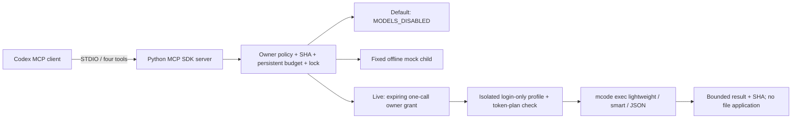

# MiniMax MCP Bridge v1 — independent, proposal-only

Owner scope: separate task branch and Draft PR; no live model calls, dispatcher changes,
merge, force-push, main, production data, scheduler activation or global Codex settings.
Base: `fcac8fda1ed4932be9e77a9d4d29e86d0971e111` (#69).

## Research and architecture decision

Checked local launchers: **Codex CLI 0.160.0**, **MiniMax Code CLI 0.6.12**
(`@minimax-ai/code`, not the unrelated media/API CLI). Python runtime: 3.13;
official MCP Python SDK pinned to **mcp 1.28.0** in a new worktree-local venv.
Help/version/schema generation and protocol discovery are not model turns.

MiniMax's [official CLI documentation](https://agent.minimax.io/docs/cli/features)
describes headless `mcode exec`, JSON/stream JSON, and ACP over STDIO.
The installed `mcode --help` offers `exec`, `acp` and `app-server`, but no native MCP
server entry point. **Native MiniMax MCP serving is not established.** Its MCP client
capabilities, ACP server and SSH app-server are different interfaces.
Installed `mcode exec --help` confirms `--input -`, `--input-format text|json`,
`--output-format text|json|stream-json`, `--timeout`, `--max-steps`, `--cwd`,
`--config`, `--mode standard|lightweight`, and `--permission smart|full|off`.

The [official MiniMax README](https://github.com/MiniMax-AI/minimax-code#lightweight-conversations)
describes lightweight sessions as omitting tools, workspace rules, skills, memory and
MCP schemas. v1 deliberately uses this mode for **proposals**, with a new session each
time. It does not expose standard coding mode or claim automatic file repair.
The [installation documentation](https://github.com/MiniMax-AI/minimax-code/blob/main/docs/installation.md#accounts-and-data)
separates installation from data directories and documents the two data-dir overrides.
Public source preview and the installed npm artifact are distinct evidence; their
capability equivalence has not been validated with a live call.

| Architecture | What it adds | Isolation implications | Decision |
| --- | --- | --- | --- |
| Direct CLI Bridge | Fixed argv, process lifecycle, JSON parsing | Same profile/process risks as before unless separately closed | Necessary execution backend, insufficient discovery contract |
| MCP Bridge over CLI | Four typed tools, STDIO initialize/discovery, persistent receipts | MCP is a transport, not a sandbox; enforce policy in backend | **Chosen**, official SDK plus bounded CLI backend |
| Codex App Server | Long-lived Codex threads, events, approval/lifecycle protocol | Does not turn MiniMax into MCP or isolate its profile | Use only for quota-free integration verification; no second orchestrator |

[Codex MCP configuration](https://learn.chatgpt.com/docs/extend/mcp?surface=cli)
supports STDIO servers and trusted-project `.codex/config.toml`.
[Codex App Server](https://learn.chatgpt.com/docs/app-server) exposes MCP discovery
and tool calls. The verifier never sends `turn/start` and uses an empty temporary
Codex home with an unusable loopback model-provider URL and no account credentials.
Implementation follows the [official MCP Python SDK](https://github.com/modelcontextprotocol/python-sdk/tree/v1.28.0).



## Previous failures: evidence and limits

Current GitHub metadata was verified with owner-account `gh` after the connector failed:

| PR | HEAD | Meaning |
| --- | --- | --- |
| [#59](https://github.com/gremoled77-droid/gremovod/pull/59) | `70324c1ff9929e81d6eecacfc01dec4fc2212174` | Existing Dispatcher v2 |
| [#69](https://github.com/gremoled77-droid/gremovod/pull/69) | `fcac8fda1ed4932be9e77a9d4d29e86d0971e111` | Isolation hardening is present, still Draft |
| [#70](https://github.com/gremoled77-droid/gremovod/pull/70) | `a2b999df0196539361a22bc93a39ce594389ed45` | Failed smoke, unchanged remote fixture SHA |

The committed [owner result](AUTONOMOUS_RESULT_2026-10-21.md) and its
[phase journal](evidence/autonomous-smoke-events.jsonl) show `FIX_RUNNING` at
2026-10-21T20:01:25.357353Z, then `HALTED/MINIMAX_FAILED` at
2026-10-21T20:02:15.396935Z. MiniMax edited the fixture, used unrelated shared-profile
MCP tools, and ended aborted without a final result. The old implementation discarded
the numeric child exit and stderr. **Exact abort cause is unknown**; max-step exhaustion
is a hypothesis, not a proven authentication failure. No new reviewed fix SHA exists.

The latest local profile diagnostic (`outputs/PROFILE_ISOLATION_CHECK_2026-10-21.md`,
outside the repository) found no dedicated logged-in profile, a Windows junction bypass
of `is_symlink()`, and accepted synthetic `v2/plugin-cache`. It did not prove plugin
execution. The later scheduler failure is consistent with the existing STOP guard;
old `MINIMAX_FAILED` was reused in reporting. Scheduler stderr was absent, so this is
an inference, not proof of a second MiniMax invocation.

v1 therefore rejects reparse points/ancestors and hardlinks, rejects all profile input
outside `auth/**/auth.json`, supplies both data-dir overrides and fresh HOME/XDG/temp,
removes inherited API/MCP/Node/Python/proxy variables, and starts in an empty scratch
directory. A runtime tool YAML alone is not used as a capability firewall.
No credentials were opened, copied, exported or logged during this implementation.

## Files and contracts

All new executable code is in `scripts/minimax-mcp/`:

| File | Purpose |
| --- | --- |
| `server.py` | Official SDK STDIO server and exactly four tools |
| `bridge.py` | Validated file input, owner gate, persistence, process tree, limits |
| `mock_worker.py` | Fixed offline child, errors/timeouts/environment fixtures |
| `test_bridge.py` | Unit and real STDIO protocol tests, no models |
| `requirements.txt` | Pinned official SDK |
| `configure.py` | Generate project-only disabled or mock config, refuse overwrite |
| `verify_codex.py` | Non-inference Codex registration/discovery/tool-call proof |
| `fixtures/value.py` | Harmless source fixture |

`.gitignore` excludes generated `.minimax-mcp/` and local `.codex/config.toml`.
This report and sanitized verification evidence are the remaining tracked files.
`scripts/agent-handoff/` is byte-for-byte unchanged from the base.

`minimax_execute(request_id, task, head_sha, files)` has no command, cwd, permission,
enable switch, CLI override or grant argument. Only owner-startup policy selects those.
File paths must exactly match its allowlist, be tracked/clean UTF-8 text, and match the
current branch/SHA. No shell commands, commits, pushes, tests or file application are
offered through MCP. Task/file contents go as JSON data on stdin, never CLI arguments.
`minimax_status` does no CLI/account probing. `minimax_result` returns timestamps,
PR, source/result SHA, numeric exit code and bounded redacted stdout/stderr.
`minimax_cancel` affects only the Bridge-owned process tree.

One server holds an OS file lock for the state directory. One job is active at a time.
Identical IDs return the original receipt; changed payloads with the same ID fail.
Calls are durably reserved before launching. Maximum startup allowance is three;
generated config allows one; a live grant allows one. Reservations survive restart.
Interrupted jobs become UNKNOWN, retain their reservation and block execution.
Any execution error, timeout, cancellation, invalid JSON, STOP or changed HEAD halts
new work. Successful transport completion is **not** ACCEPT or independent code review.
Known secret formats are redacted; the action journal excludes all prompts/outputs.

On Windows the child starts suspended, joins a kill-on-close Job Object, then resumes.
This controls lifetime and descendants; it is **not a filesystem sandbox**.
The current safety boundary is no model file/shell tools, explicit content forwarding,
and a trusted installed CLI. Same-user malicious native code or arbitrary host shell
access is outside this boundary. Standard-mode editing needs a separately reviewed
OS sandbox; do not enable it by changing an argument.

## Windows installation and offline verification

From this separate worktree, using a locally installed Python 3.13:

```powershell
py -3.13 -m venv .venv
.\.venv\Scripts\python.exe -m pip install -r scripts\minimax-mcp\requirements.txt
.\.venv\Scripts\python.exe -X utf8 -m unittest discover -s scripts\minimax-mcp -p test_bridge.py -v
.\.venv\Scripts\python.exe scripts\minimax-mcp\configure.py --pr 72
```

The default policy is disabled. The generator refuses an existing config/state; it
does not replace project settings, clear STOP, reset budgets or log into anything.
Its `--mode mock` option is only for a fresh standalone offline installation.
Generated paths are absolute and local, so the config is intentionally untracked.

Trust this project in the Codex UI if desired, then `codex mcp list --json`.
The verifier instead writes trust into its isolated temporary Codex home's config
before loading project settings (CLI `-c` trust alone did not load them in 0.160.0);
it does not modify global trust/config or copy authentication:

```powershell
.\.venv\Scripts\python.exe scripts\minimax-mcp\verify_codex.py --codex 'C:\absolute\path\to\codex.exe'
```

The exact binary is under the installed `@openai/codex-win32-x64` vendor directory.
Verification first discovers the actual project entry in disabled mode, then makes
a temporary process-only mock-policy override, calls tools and verifies the SHA.
The project policy stays disabled. Results are written under `.minimax-mcp/verification-*`.

Manual server launch (an MCP client must own its STDIO):

```powershell
.\.venv\Scripts\python.exe scripts\minimax-mcp\server.py --config .minimax-mcp\policy.json
```

Emergency stop for this Bridge, including active work:

```powershell
New-Item -ItemType File -Force .minimax-mcp\state\STOP
```

This does not change or restart the previous dispatcher. Its STOP/budgets and the
disabled scheduler tasks remain separate and must not be reset as part of Bridge setup.

## First separately authorized real smoke — not run

1. Review this Draft, its exact HEAD, offline evidence and remaining limitations.
2. Approve **one** subscription-only MiniMax call, at most 120 seconds total runner
   time and one assistant step, no Codex inference calls, no automatic retries.
   CLI flags do not cap exact subscription tokens or prove billing eligibility.
3. Owner performs normal login in a new dedicated Bridge profile. Never copy the
   shared account files. Inspect filenames and actual no-tools capability behavior;
   login-only policy rejects unexpected configuration instead of relaxing it.
4. Prepare a separate live policy/state bound to the test PR, branch and SHA, installed
   Node/CLI absolute paths, and this fixture only. Keep the installed project disabled.
   Fixed model is `minimax/MiniMax-M3.1-Flash`, as in the existing subscription runner;
   availability in the new profile is unverified. No alternative provider fallback.
5. Only after that explicit approval, owner creates an out-of-band approval file with
   `request_digest` (SHA-256 of sorted JSON `{task, head_sha, files}` using `bridge.digest`),
   exact `head_sha`, `pr_number`, `capability: lightweight-no-tools`, `max_calls: 1`,
   `subscription_only: true`, and a timezone-aware ISO `expires_at`.
   No MCP tool can create or change this grant. File presence is an operational owner
   gate, not protection against another same-user program writing files.
6. Run once, request a textual proposal only, collect exit/stderr/JSON/SHA, confirm no
   unexpected tool use, then STOP. An absent/expired/mismatched grant, missing CLI/auth,
   API provider, unexpected profile tree or changed SHA blocks. No automatic reapproval.

The live path and subscription login remain **NOT LIVE-VERIFIED**. No MiniMax inference,
Codex inference, production Studio, working SQLite, n8n activation, media generation,
autonomous GA task, merge or deployment is part of this proof.

## Verification record

Initial full offline suite: **30 tests pass**, including official SDK initialize,
four tools and schema checks; real mock subprocess, numeric exit 23 and stderr
redaction; timeout/cancellation and Windows descendant termination; dedupe/single lock;
restart and budgets; environment/home/config isolation; source SHA before/after;
missing CLI/auth/approval; junction/hardlink/foreign file/secret input rejection;
mocked live command contract and API-provider refusal.
SDK 1.28.0 with current pydantic-settings emits an `IncompleteFieldDefinitionWarning`
on stderr about its lifespan type. Protocol/schema tests still pass; stdout stays MCP.
Codex 0.160.0 also detected the actual project registration and discovered all four
tools through App Server, received `MODELS_DISABLED`, then obtained a successful
mock result through `mcpServer/tool/call` with the exact source SHA. No `turn/start`
was sent. Global config and the disabled project policy remained unchanged.
Published proof: [Codex MCP evidence](evidence/minimax-mcp-codex-offline.json).
The report binds its input commit and hashes the Bridge source files; adding this
evidence afterward does not change those verified executable bytes.

[Draft PR #72](https://github.com/gremoled77-droid/gremovod/pull/72) is stacked on #69.
The live-path restriction to proposals is intentional: this does not replace the
dispatcher's code-fix/test/commit/push cycle or authorize autonomous GA execution.
