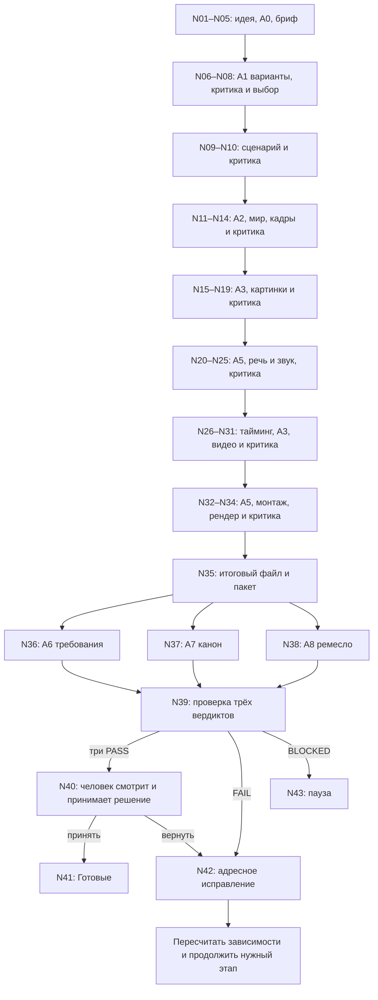

# Полный производственный процесс GremoVOD в n8n

Версия 1.0-review, 19.10.2026. Запрос владельца: от идеи до готового файла, с критикой на каждом этапе и решением человека в конце. Статус — спецификация для обзора GPT Astra, не готовая автоматизация.

## 1. Цель и границы

Автор вводит идею A0. A1 развивает её и предлагает варианты. Режиссёр подбирает персонажей, локации, кадры, действия и подачу реплик. Затем система производит реальные изображения, звук, видео и монтаж. Каждый этап проверяется по своему фактическому результату; замечания возвращаются конкретному исполнителю. Три независимых финальных критика смотрят один и тот же итоговый файл. После трёх PASS человек решает, отправлять ли эту версию в «Готовые».

A0–A8 — предложенное техническое разделение обязанностей, а не неизменяемый авторский замысел. Изменение состава или физической компоновки узлов допустимо, если сохраняются ответственность, независимость критики и наблюдаемость процесса. Наличие роли с названием «монтаж» не заменяет монтажный инструмент.

Первой собирается вся видимая схема, затем поэтапно наполняется исполнением. Текстовый пилот — только участок общей системы. Критерий полной готовности: реальная небольшая сцена прошла весь путь до принятого файла, включая намеренно внесённый дефект и адресное исправление. Текстовый demo PASS не равен этому критерию.

Не входят в запрос: автоматическая публикация в соцсети, изменение main, запуск платных тестов без отдельного бюджета, массовое обучение персонажей, немедленная переделка сайта. Сначала n8n и реальные файлы, затем Studio по проверенному процессу.

## 2. Исполнители

| Роль | Обязанность | Что не делает |
|---|---|---|
| A0 | Бриф, координация, рекомендация маршрута, разбор главного дефекта | Не заменяет критиков, не утверждает канон и финал за человека |
| A1 | Варианты идеи, история, сценарий и смысловой текст реплик | Не запускает генераторы и не подменяет постановку |
| A2 | Персонажи/локации, мизансцена, кадры, игра и подача реплик, камера, тайминг | Смысловую правку текста возвращает A1, не меняет сценарий молча |
| A3 | Подготовка image/video промптов и помощь с API-профилями | Не собирает произвольный JSON API и не разрешает себе расходы |
| A4 | Исследование конкретных доступных источников по запросу | Не симулирует чтение недоступных PDF и не принимает факты за канон |
| A5 | План звука, монтаж, таймлайн, подготовка экспорта | Реальный синтез/рендер выполняется подключённым инструментом |
| A6 | Независимое соответствие заданию | Не судит по вкусу и не чинит собственноручно |
| A7 | Независимая согласованность мира, образов и непрерывности | Не дописывает канон ради оправдания результата |
| A8 | Независимое ремесло по явным критериям и доступному материалу | Не объявляет просмотр по описанию; не получает бюджет сам от себя |

Код управляет разрешёнными переходами, версиями, idempotency и расходами. Предложение A0 не даёт права вызвать произвольный инструмент. Каждый вызов роли или критика имеет модель/провайдера из проверенного профиля, а не модель, угаданную LLM.

## 3. Карта этапов

| Этап | Ноды | Реальный результат |
|---|---|---|
| Вход и постановка | N01–N05 | Версионированный бриф и требования |
| Разработка идеи | N06–N08 | Проверенные варианты и зафиксированный выбор |
| Сценарий | N09–N10 | Сценарий с репликами и ID |
| Режиссура и мир | N11–N14 | Комплект референсов, география, карточки кадров |
| Изображения | N15–N19 | Сохранённые проверенные кадры |
| Голоса и звук | N20–N25 | Сохранённые проверенные дорожки и тайминг |
| Видео | N26–N31 | Сохранённые проверенные клипы |
| Монтаж | N32–N34 | Собранный и проверенный master |
| Финальные критики | N35–N39 | Три независимых вердикта одного файла |
| Решение и Готовые | N40–N41 | Явно принятый файл и manifest |
| Исправление/пауза | N42–N43 | Узкая правка либо сохраняемый checkpoint |

Для нескольких сцен/кадров image/audio/video ветки выполняются по ID. Переход к монтажу разрешён только когда все обязательные позиции выбраны и проверены. Параллельность ограничивается доступным бюджетом/провайдером; для первого пилота допустимо последовательное исполнение. Шаг, не требуемый брифом, имеет явное N/A/SKIPPED с основанием, а не поддельный PASS.

Обратные связи промежуточных критиков описаны для каждой ноды в NODES.md. Схема не требует возвращаться в начало при дефекте одного кадра.

## 4. Проверка каждого этапа

S07 — общий подмаршрут критики. Узлы N07/N10/N14/N19/N25/N31/N34 вызывают его с разными пакетами. Нельзя считать промежуточный PASS разрешением на финальную сдачу.

| Область | A6 проверяет | A7 проверяет | Ремесленная критика A8 |
|---|---|---|---|
| Варианты/сценарий | События, формат, объём, реплики, запреты | Правила мира и характеров | TEXT_CRAFT: конфликт, причинность, раскрытие, диалог по тексту |
| Режиссура | Покрытие сценария кадрами, тайминг | Ось, география, образы, реквизит | PLAN_CRAFT: читаемость и выразительность постановки как плана |
| Изображение | Наличие требуемого действия/состава | Лицо, одежда, локация, постоянные детали | IMAGE_CRAFT: свет, композиция, фокус внимания на самой картинке |
| Аудио | Полнота и произношение текста, длительность | Персонаж/голос, согласованность | AUDIO_CRAFT: интонация, темп, паузы, разборчивость и микс |
| Видео | Действие и речь в нужное время | Дрейф внешности/геометрии, непрерывность | VIDEO_CRAFT: движение, игра, камера, lip-sync по реальным данным |
| Монтаж/финал | Полнота, порядок, форматы | Согласованность всей сцены | FINAL_CRAFT: ритм, стыки, звук и общий эффект по bar/эталону |

Базовая обязательная критика каждого этапа — A6 и A7. Для реальных image/audio/video/edit результатов ремесленная критика A8 обязательна в полной версии; в раннем пилоте её отсутствие должно быть явно видно как неполная проверка. TEXT_CRAFT/PLAN_CRAFT — дополнительные режимы будущей реализации, обязательность задаётся зафиксированной политикой задачи; исключать их по решению автора результата нельзя. Финальные N36/N37/N38 всегда обязательны, не имеют N/A и не подменяются голосованием.

Сейчас сохранённый A8 предназначен только для реальных медиа и выключен. Этот документ НЕ включает его и НЕ меняет его инструкции. TEXT_CRAFT/PLAN_CRAFT нельзя реализовать простым отправлением текста существующему A8: потребуется отдельное согласованное изменение/роль с точным контрактом. Текстовый предварительный этап может пройти A6/A7; финальный медиапроход остаётся BLOCKED до реализации A8 и доступа к материалу.

Для всех режимов: критик получает только артефакт, свою часть требований/канона/bar и минимальные ID; не получает историю изготовления, самооценку автора и вердикт другого критика. Новая сессия и отсутствие инструментов доступа к другим данным обязательны. Три финальных пакета ссылаются на одинаковый checksum файла. Для A7 разрешены только относящиеся к задаче утверждённые эталоны, не весь архив проекта.

PASS означает покрытие всех обязательных критериев. FAIL — наблюдаемый дефект и одна крупнейшая проблема. BLOCKED — не хватает разрешения, источника, доступа или возможностей проверки. Текст, URL, промпт, лог сборки и схема кадра не доказывают просмотр медиа. Транскрипт доказывает слова, не тембр; отдельные кадры не доказывают весь звук/движение. Если необходимых наблюдений нет, область BLOCKED. Код проверяет структуру и происхождение evidence; смысловое качество нельзя гарантировать одной проверкой цитат.

## 5. Навыки и профили моделей

S02 выбирает обязательный навык этапа и дополнительные навыки по задаче; загружает содержимое и нужные справки; сохраняет skill ID/version/hash и краткую связь «знание → решение». Для портрета могут требоваться кадрирование/свет/оптика; для общего плана — композиция/география/глубина; свет не ограничен портретом. Нельзя механически передавать все инструкции всем агентам.

S03 хранит точную комбинацию model/version/mode/provider. Три слоя: официальные документы с источником и датой проверки; практические правила промптинга; машинный контракт API. Вызов получает релевантные разделы и обязательные ограничения. GPT Image, Seedream, Qwen, Seedance и Kling здесь — примеры разных подключений, не утверждение об их конкретных лимитах. Каталог и цены нужно проверить до реализации адаптера и live этапа.

Художественное описание формирует агент, структуру запроса/поля/порядок референсов формирует код адаптера. Перед отправкой выполняются программная проверка и независимая содержательная проверка. В предпросмотре видны файлы/роли, промпт, параметры, ограничения и стоимость. Изменение любого входа аннулирует прежний request_hash и его разрешение. Изменение выбранной модели пересобирает запрос из исходной постановки.

Документация и навыки версионируются; инструкции из интернета не могут включать вызовы, повышать бюджет или менять канон. Автосинхронизация GitHub→saved Agents→workflow не считается уже существующей. Для пилота допускается контролируемый снимок без credentials, с проверкой хэшей и остановкой при расхождении.

## 6. Хранилища персонажей и мира

Хранилище переносимо между провайдерами; данные не должны существовать только внутри Soul ID/LoRA. В пилоте достаточно ручного манифеста исходников, затем автоматизировать по подтверждённым потребностям.

Персонаж: ID, версия образа, период/возраст, наблюдаемые черты, одежда, original/candidate/approved. Отдельные качественные виды лица анфас/три четверти/профили, фигура спереди/сбоку/сзади, детали и выражения по задаче. Обзорный лист не заменяет отдельный крупный портрет. Сгенерированная неизвестная сторона — кандидат; апскейл не делает её достоверным оригиналом. Подбор референсов учитывает роль изображения, нужный ракурс и лимиты API. Обученная идентичность — опциональный провайдерный механизм с отдельным бюджетом, не обязательная основа системы.

Локация: ID/версия, общие и обратные виды, схема сверху, связи пространств, двери/окна/ориентиры, постоянные материалы и предметы. Неизменяемая геометрия отделена от времени суток/погоды/света/положения временного реквизита. Неизвестная часть не придумывается молча. План/панораму/3D передавать модели только при подтверждённой поддержке; при необходимости подготовить обычный рендер вида. 3D не обязательная зависимость первого пилота.

Референсы персонажей, локации, позы, композиции и света имеют разные роли. Подмена одного другим запрещена. Система показывает владельцу, если лимита входов не хватает для обязательных источников. Новый результат не становится эталоном автоматически. Правки библиотеки и смена версии образа аннулируют зависимые проверки, но не удаляют старые файлы.

## 7. Речь, видео и монтаж

Базовый пилот использует заранее полученную проверенную речь для фактического тайминга, затем видео. Это техническая последовательность, а не запрет нативной речи. Если выбранная модель поддерживает native audio/dialogue и задача этого требует, N20–N25 подготавливают текст/голосовую стратегию, синтез речи откладывается в video job; пропущенные операции явно помечаются. N31 проверяет и реальную речь, затем N25 выполняет аудиопроверку полученной дорожки до N32. Внешний TTS поверх уже принятой нативной речи не добавляется автоматически.

Полную речь сохранять, сегменты выбирать по словам/паузам/смыслу с учётом лимита модели. Не ускорять голос и не обрывать реплики ради красивого числа секунд. Тайминг проверяется по реальному файлу. Изменение текста после записи запускает пересчёт зависимостей N20→N26→монтаж, а не только замену подписи.

Image/video/TTS/SFX/music/lip-sync/upscale/монтажный worker — реальные отдельные инструменты. Текстовая роль может подготовить параметры, но не объявляет файл существующим. Получение каждого результата включает проверку body-level status провайдера, сохранение файла, checksum и декодирование. Код и CapCut-проект не равны итоговому MP4. Если экспорт выполняется человеком, маршрут ждёт импорт и проверку готового файла и явно показывает ручную зависимость; полная автоматическая сборка требует настроенного worker.

Форматы 16:9/9:16 определяются брифом, не обязательны оба по умолчанию. Разные композиции/выходы имеют отдельные версии и критерии. Для двух требуемых файлов каждый проверяется и принимается; успех одного не переводит второй в Готовые.

## 8. Минимальные контракты данных

| Объект | Поля, обязательные по смыслу |
|---|---|
| Task | project_id, task_id, run_id, original_idea, brief_revision, requirements_revision, canon_scope/version, output_spec, stage_policy |
| Artifact | artifact_id, revision, kind, status, content_hash, source_assets[], dependency_versions, stage, creator_role |
| Asset | asset_id, media_type, storage_ref, checksum, dimensions/duration/streams при наличии, origin, reference_role, approval_status |
| Model request | request_id, idempotency_key, provider/model/version/mode, profile_hash, skill_manifest, actual_payload_hash, reference_roles, reservation_id |
| Provider job | job_id, request_id, provider_job_id, submit_state, body_status, result_asset_ids, usage, cost_state, execution_id |
| Review | review_id, role, phase, artifact_revision/hash, input_manifest_hash, requested/checked scopes, checks[], verdict, evidence[], biggest_gap, missing_inputs, reviewer_model/config_version |
| Decision | actor_id, action_type, object_id/revision/hash, conditions, created_at, expiration если нужно, explicit=true |
| Ready release | release_id, final_asset_id/hash, three_review_ids, owner_decision_id, output_spec_version, destination, accepted_at |

Это смысловые контракты спецификации, не готовая JSON Schema. Допустимые поля, типы, лимиты, подписи и ошибки формализуются при реализации конкретных границ. LLM-ответ — недоверенный вход; provider model/usage брать из реального ответа, не из самоотчёта LLM. Секреты хранятся отдельно и не входят в prompt/manifest/Git.

## 9. Статусы и остановки

Артефакт: DRAFT → IN_REVIEW → STAGE_PASSED либо CHANGES_REQUESTED/BLOCKED. После финального QA: AWAITING_OWNER_APPROVAL → READY только в N40/N41. Канонический APPROVED_REFERENCE — отдельное состояние; STAGE_PASSED не переводит туда автоматически.

Provider job: PREPARED → AUTHORIZED → SUBMITTING → SUBMITTED → RUNNING → SUCCEEDED/FAILED; UNKNOWN возможен после неясного результата отправки/таймаута. UNKNOWN блокирует повтор до сверки. CANCEL_REQUESTED не равно отмене провайдером; уже понесённые расходы учитываются.

Финальный агрегатор ожидает терминальные ответы всех обязательных критиков или явную остановку. Невалидный/неполный ответ — BLOCKED, не исчезнувший голос. При сочетании FAIL и BLOCKED сохраняется известный repair plan, но этап остаётся BLOCKED до решения о продолжении/полноте проверки. Три PASS разных ревизий не складываются в успех. Результаты, пришедшие после смены версии, сохраняются как stale, не меняют текущий статус.

## 10. Петля исправлений и зависимости

N42 выбирает ближайший корневой этап по evidence. Код проверяет разрешённый target. Текстовая проблема → A1, постановочная → A2, промпт/параметры → A3, звук/монтаж → A5/инструмент, исходный референс → N12 с решением владельца. Изменение канона не является штатным способом исправить FAIL.

| Правка | Что обычно пересчитывается |
|---|---|
| Опечатка в титре | Титры/монтаж, новый master, финальные три критика |
| Свет одного кадра | Промпт/изображение этого кадра, зависимый клип/монтаж, финальные три критика |
| Ошибка произношения | Сегмент аудио, зависимый тайминг/lip-sync/монтаж, финальные три критика |
| Новая реплика | Сценарная проверка, аудио/тайминг и затронутые кадры/клипы/монтаж |
| Новая геометрия локации | Эталоны с утверждением, все зависимые виды/клипы/проверки |

Граф зависимостей определяет точный набор; таблица не разрешает игнорировать новые связи. Старые принятые дубли сохраняются. После любого изменения итогового файла три финальных вердикта выполняются заново для нового hash. Человек возвращает замечание в ту же систему, а не запускает весь проект заново.

Политика числа исправлений/времени/расходов фиксируется до запуска. Предложение пилота: максимум одно автоматическое исправление на этап и общий денежный/временной потолок; точные суммы определяются после выбора моделей. Достижение лимита → N43, не бесконечная петля. Утверждение бюджета может покрывать ограниченный пакет заранее; не требуется повторный вопрос на каждый уже разрешённый вызов.

## 11. Исполнение в n8n

Основное полотно показывает все этапы и статусы; повторяемые операции вынесены в sub-workflow. Узел имеет отображаемые ID/название и соответствует строке каталога. Общие S01–S09 вызываются из подходящих узлов; это не девять новых AI-персонажей.

Для первого реализуемого пути выбран Execute Sub-workflow с явными ролевыми workflow. Это НЕ вызов saved Agent по agentId. Источник инструкций/навыков единый и версионированный; снимок из сохранённого Agent можно использовать как контролируемую начальную копию с фиксацией hash и проверкой расхождения. Не поддерживать молча две редакции.

Сохранённые Agents n8n имеют subAgents, но общий workflow их сейчас не вызывает. Официальная документация описывает Message an Agent v3.1 как мост к saved Agents; MCP текущего экземпляра одновременно помечает этот тип retired. Это нерешённое расхождение, не доказательство глобального удаления. Не строить на спорном узле новый маршрут до подтверждения поддержки. Не придумывать HTTP endpoint. Если расхождение будет разрешено, способ вызова можно заменить за теми же входными/выходными контрактами.

Источники: [Message an Agent](https://docs.n8n.io/integrations/builtin/core-nodes/n8n-nodes-base.messageanagent.md), [Build and manage agents](https://docs.n8n.io/build/build-and-manage-agents/), [Execute Sub-workflow](https://docs.n8n.io/integrations/builtin/core-nodes/n8n-nodes-base.executeworkflow/). Проверены в этой сессии 19.10.2026; runtime-ограничение получено get_node_types. Доступность конкретного transport в нашей инсталляции не испытана модельным запуском.

Локальные Windows-файлы недоступны n8n Cloud по строке пути. Передача использует утверждённую загрузку/временный доступ или исходящий локальный worker. SQLite и локальный FastAPI не открываются наружу ради пилота. Полная Studio не обязательна: ручной manifest, контролируемый файловый storage и worker могут обеспечить пилот. В будущем FastAPI становится источником истины; n8n возвращает предложения/файлы через защищённый контракт, не пишет напрямую в базу.

## 12. Фактическая отправная точка

Снимок из чтения конфигураций в этом чате, 19.10.2026; не обещание неизменности облака:

- Существуют девять unpublished Agents A0–A8 с прикреплёнными навыками. A0 содержит ссылки A1–A7; A8 enabled=false. Инструменты чтения файлов/генерации/монтажа к этим Agents не подключены.
- Studio v1: 15 узлов, локальные workflow-агенты A0/A1/A2/A3, не ссылки на saved Agent IDs.
- Safe QA draft: 7 узлов, Code gates возвращают BLOCKED, живых критиков не вызывают.
- E2E demo: 8 узлов, встроенный синтетический бриф, Gemini writer и два Gemini role prompts A6/A7, проверка цитат, owner gate. Изображений/видео не генерирует.
- Все три прочитанных workflow не активированы. Их графы не содержат вызовов девяти saved Agents по ID.
- Инструкции/QA-навыки A0/A8 согласованы в предыдущем шаге: различаются TEXT_PRECHECK/FINAL_MEDIA, A8 остаётся на Sonnet и отключён. validate_agent прошёл, поведение не испытано. Для этого документа n8n дополнительно не менялся.
- Отдельный отчёт ранее подтвердил 46/46 offline QA/FastAPI-тестов; это не проверка данного полного маршрута. В этой задаче приложение и модели не тестировались.

Статусы каталога: ROLE_ONLY — есть роль/инструкции, не готовая операция; PARTIAL — есть отдельные демо/навыки; NEW — требуется реализация. Ни один из этих статусов не означает production-ready.

## 13. Обзор и решения до live

Сначала GPT Astra проверяет полноту процесса, распределение обязанностей, циклы и зависимости. Затем фиксируются спорные решения: обязательность TEXT_CRAFT/PLAN_CRAFT, модель/провайдер для каждого критика и инструментов, контролируемый доступ к файлам, где хранится журнал/approval пилота, способ автоматического рендера и сумма бюджета.

После обзора идут этапы из IMPLEMENTATION_AND_ACCEPTANCE.md. Любой пример в документах — постановка проверки, не разрешение на расход. Критерий успеха всего проекта — реальная законченная и принятая сцена, а не количество узлов, агентов или зелёных технических executions.

## 14. Astra v1.1 — обязательный протокол исполнения (19.10.2026)

Применяется [ASTRA_FIXES_V1_1.md](ASTRA_FIXES_V1_1.md). Понятие «проект готов к исполнению» в ранней версии следует отличать от «контракты описаны»: ноды N12/15/19, N20/22/25/26, N28/29/30, N32–41 и сервисы S01/S04/S05/S06/S08/S09 имеют необходимые уточнения в `nodes.json.astra_v1_1` и `conditional_routes`.

- **Состояние:** для пилота единственная долговременная база — существующий FastAPI/SQLite; n8n execution не источник истины, двойной resume регулируется ревизией/атомарным lease.
- **Расход:** владелец разрешает ограниченный BudgetGrant, каждый конкретный неизменяемый запрос получает отдельную проверку hash/profile/cost. UNKNOWN не повторяется и не освобождает резерв без сверки.
- **Ветвления:** native речь не исключает музыку/SFX и не даёт фактический тайминг до N30; lip-sync — отдельный оплачиваемый job с повторным N28 preflight; reference_candidate возвращается на утверждение в N12; монтаж ждёт полного frozen slot manifest.
- **Релиз:** N34 — техническая проверка, N36–N38 — три независимые содержательные проверки одного полного snapshot, N39 отбрасывает дубли/устаревшие решения; N41 перепроверяет состояние и доверенное решение владельца. Без реально доступных VIDEO/AUDIO evidence => BLOCKED.
- **Границы:** изменение текста/spec/JSON не подтверждает навыки провайдера, актуальные цены, наличие файла или безопасный облачный канал. До реального MP4 и интеграционного теста соответствующие статусы остаются NOT_IMPLEMENTED/BLOCKED.

## 15. Реализация в семи модульных workflow, старт после 19.10.2026

Владелец разрешил автоматическое продвижение между этапами разработки без дополнительных промежуточных сообщений; **все вопросы с риском расходов, изменения рабочей SQLite, публикации или канона фиксируются** в `docs/CODEX_DECISIONS.md` для Codex. Отсутствие подтверждённого runtime owner budget/session не отменяется таким поручением.

**Ровно семь рабочих физических модулей**, а номера N01–N43/S01–S09 остаются логическими IDs: `WF_00_Core_Infra`, `WF_01_Writers_Room`, `WF_02_Canon_And_Images`, `WF_03_Audio_Factory`, `WF_04_Video_And_LipSync`, `WF_05_Assembly_And_Critics`, `WF_06_Repair_Router`. Реестр имён/IDs n8n и результат бесплатного исполнения #39 — `integrations/n8n/WF_00_WF_06_MANIFEST.json`. Старые отдельные test-workflows — не производственные модули и не входят в эти семь.

**Пилотный звук:** в N20 фиксируется `speech_strategy=external_tts` (на mock — `external_tts_mock`). Обязательные независимые дорожки `voice/sfx/music`, ambience — отдельная опция. Фактическая длительность voice измеряется `ffprobe`, только затем N26 получает реальный тайминг. `native_audio=false` до отдельного исследования Codex. В N29 → N30 video-generation и последующий lip-sync всегда **разные** jobs, другой budget grant и hash; провал lip-sync не запускает повторный исходный video generation.

**БД:** реальная `backend/main.py` уже имеет legacy таблицу `jobs`; используется дополнительная `db/schema.sql` с пятью prefixed `p0_*` таблицами. Нет миграции на рабочем ПК в рамках GitHub PR, нет изменения `backend/main.py` и HTTP routes до архитектурного ревью Codex. Тесты в CI проверяют временную SQLite и аварии, а локальный инструмент `scripts/p0_migrate.py` по умолчанию делает сухой просмотр и требует `--apply` + новую backup path для записи.

**Физическая FFmpeg-проверка:** `tools/mock_media_pilot.py` генерирует 3 синтетических кадра/3 звука в пустом временном каталоге, сцепляет MP4 и повторно собирает master после ремонта только `shot_02`. N34 проверяет потоки, FPS, длительность, decoding, checksum без LLM. Synthetic assets **не утверждают реальную video/audio QA**: N35 STT, N36/37/38 и owner READY остаются BLOCKED.

**Бесплатное управление 7 WF:** n8n execution #39 отработал физическую цепочку `WF_00→WF_01→WF_02→WF_03→WF_04→WF_05→WF_06` через Execute Sub-workflow с нулём API/LLM calls. Поскольку пока передаются `mock://` ссылки, это validation of orchestration only; actual real media manifest у WF_05 остаётся blocked.

**Боевые API:** `backend/p0_provider_dispatch.py` предоставляет только disabled adapter profiles TTS/image/video_generation/lip_sync и mock mode. До успешного соединения с защищённой Studio-сессией и проверенного расчёта стоимости реальные submit-функции не реализованы.
